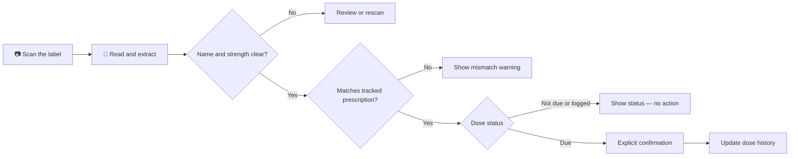
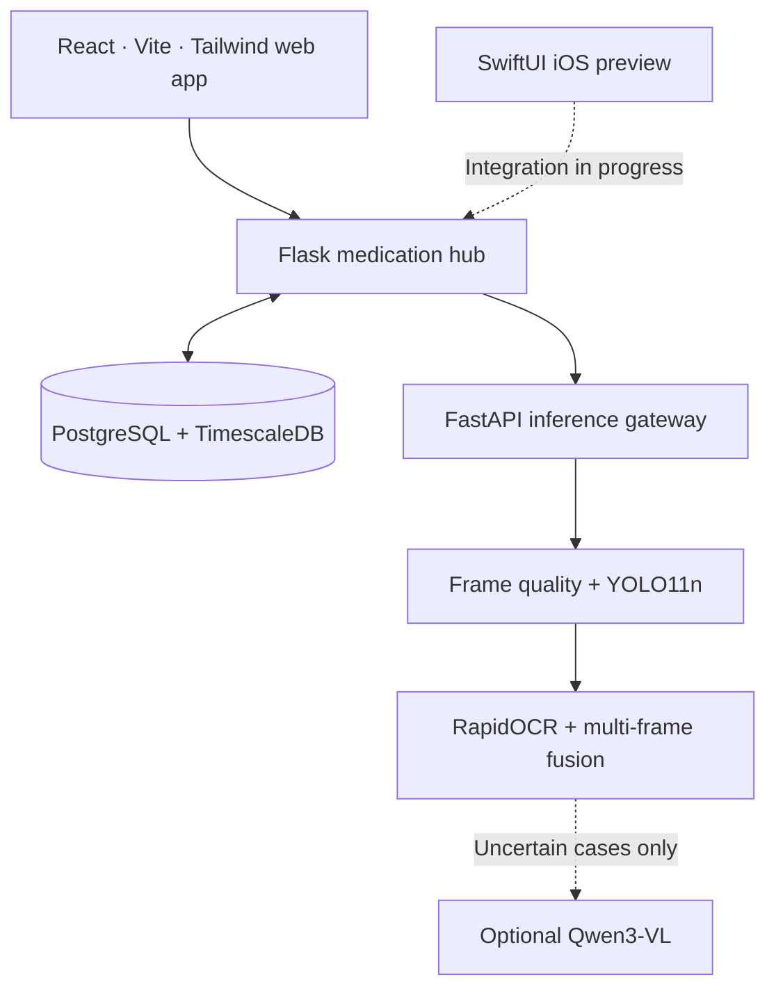

<div align="center">

# 💊 MedCheck

### The right bottle. The right details. A clearer next step.

**An accessibility-minded medication companion that reads prescription labels, checks them against tracked medications, and helps caregivers spot mistakes before a dose is logged.**

[](https://github.com/Haadesx/HackRU26)


[Why MedCheck](#why-medcheck) · [How it works](#how-it-works) · [Experiences](#the-experience) · [Architecture](#architecture) · [Try it](#try-it-locally)

</div>

---

## Why MedCheck?

A medicine bottle carries important information, but the label can be difficult to read, especially for someone with low vision. A caregiver may also need to answer a different question: **does this bottle match the medication we are tracking, and is there a dose to record right now?**

MedCheck connects those two moments. It turns a photo into readable, reviewable label details, compares the evidence with a medication record, and gives a clear next step instead of silently guessing.

> **Our principle:** A scan is evidence about a bottle—not proof that someone took a medication.

## How it works



**One scan, several possible outcomes.** MedCheck can distinguish `due_now`, `not_due`, `already_taken`, `wrong_medication`, `strength_mismatch`, and `uncertain`. Positive matches require sufficiently clear medication-name **and strength** evidence. Missing or ambiguous information does not unlock dose logging.

### A real example

| On the bottle | In the medication record | MedCheck response |
|---|---|---|
| Lisinopril **20 mg** | Lisinopril **10 mg** | **Strength mismatch** — no dose-logging action |
| Unreadable strength | Lisinopril 10 mg | **Uncertain** — check the label or rescan |
| Correct name + strength | Matching prescription, dose due | **Due now** — a separate confirmation is available |

These are application verification states, **not instructions to take or skip a medication**. Medication decisions should follow the prescription and qualified clinical guidance.

## The experience

| | What you can do |
|---|---|
| **Scan & understand** | Capture a label, get framing/quality guidance, and combine overlapping views of a curved or long label. |
| **Review the evidence** | See extracted medication name, strength, quantity, instructions, and other readable label details; correct anything missing or unclear. |
| **Catch mismatches** | Compare the scan with tracked prescriptions and distinguish an unexpected bottle, a different strength, or uncertain text. |
| **Confirm, don't assume** | Record ingestion only through an explicit action; the backend independently checks whether the dose is eligible. |
| **Stay on top of care** | View today's doses, supply levels, refills, adherence history, and caregiver-facing alerts in the dashboard. |

### Web dashboard — integrated demo

The React web application connects the scanner to the Flask medication hub and a persistent TimescaleDB database. It supports the full **scan → verify → review → confirm → history** journey, including clear warnings, responsive layouts, and accessible status text.

### iOS companion — native preview

A separate **SwiftUI iOS prototype** brings the same calm, readable design to iPhone and iPad. Its current screens cover:

- **Home:** medication shelf, today's doses, supply status, and attention-needed cards.
- **Scan:** camera capture, additional label photos, image-quality hints, and manual entry.
- **Verify:** confidence-aware fields to review or correct before saving.
- **History & Settings:** adherence views, caregiver preferences, and reminder settings.

The iOS app runs with sample data by default. Its live backend connection is **still being reconciled and tested**; the stable, end-to-end demonstration is the web application. Browse the [iOS source and setup guide](https://github.com/Haadesx/HackRU26/tree/feat/frontend-ios/ios).

<!-- If the team later publishes an iOS screenshot gallery on Devpost or another approved host, link it here. Screenshots and recordings are intentionally not stored in this repository. -->

## Architecture

MedCheck keeps **label interpretation** separate from **medication authority**. The inference service reports what it can read; the backend controls prescriptions, schedules, dose events, and inventory.



| Layer | Technologies |
|---|---|
| Accessible web interface | React 18, Vite, Tailwind CSS |
| Native mobile preview | SwiftUI, AVFoundation, iOS 18+; maintained on its own branch |
| Medication backend | Flask, SQLAlchemy, PostgreSQL 17, TimescaleDB |
| Label recognition | YOLO11n ONNX, RapidOCR, image-quality checks, multi-frame text fusion |
| Optional interpretation | Qwen3-VL via an existing inference endpoint; not required for every scan |
| API contracts | FastAPI, versioned scan-response schemas, confidence and source metadata |

## Try it locally

### 1. Explore the web UI — no database required

This is the quickest way to inspect the interface. When `VITE_API_URL` is unset, the web app uses built-in sample data.

```bash

git clone https://github.com/Haadesx/HackRU26.git
cd HackRU26
git switch main
cd frontend
npm ci
npm run dev -- --host 127.0.0.1
```

Open **http://127.0.0.1:5173**. This is a **UI preview with mock data**, not a live medication-verification demo.

### 2. Run the real, database-backed flow

The full setup is a local development stack, not a hosted service. You will need Python, `uv`, Node/npm, and Docker. The validated project launcher, `scripts/run_ui_demo.sh`, assumes the developer's existing backend virtual environment and configuration; a clean clone needs those dependencies configured first.

```bash
# From the repository root: install inference and web dependencies
scripts/setup_full_env.sh
(cd frontend && npm ci)

# Set up the backend environment once
python3 -m venv backend/.venv
backend/.venv/bin/python -m pip install -r backend/requirements.txt
cp backend/.env.example backend/.env
# Set a strong JWT_SECRET_KEY in backend/.env before continuing.

# Start the existing database volume; do not wipe it
(cd backend && docker compose up -d db)
(cd backend && .venv/bin/python -m flask --app wsgi:app db upgrade)
(cd backend && PYTHONPATH=. .venv/bin/python scripts/seed.py)
```

Then, in **three terminals**, start the services:

```bash
# Terminal 1 — OCR-first inference (from the repository root)
MEDCHECK_API_MODE=real .venv-full/bin/uvicorn services.api.main:app --host 127.0.0.1 --port 8300

# Terminal 2 — medication hub (from the repository root)
cd backend
HUB_ENABLED=true CORS_ORIGINS=http://127.0.0.1:5199 \
  .venv/bin/python -m flask --app wsgi:app run --host 127.0.0.1 --port 8000

# Terminal 3 — web interface (from the repository root)
cd frontend
VITE_API_URL=http://127.0.0.1:8000/hub \
  npm run dev -- --host 127.0.0.1 --port 5199
```

Open **http://127.0.0.1:5199**. For the team's prepared development machine, see [`scripts/run_ui_demo.sh`](scripts/run_ui_demo.sh), including the file-backed adapter fallback. The optional VLM requires its separately configured, existing endpoint; the project does **not** ship model weights.

> [!CAUTION]
> `/hub` uses a demo patient without login. **Bind it to localhost only. Do not expose this demo endpoint to the internet or a shared network.** Do not use real patient data or reset persistent Docker volumes to prepare the demo.

### Verification

```bash
# Inference and adapter integration tests
.venv-full/bin/python -m pytest services tests/integration -q

# Backend tests (with its test database configured)
(cd backend && .venv/bin/python -m pytest -q)

# Frontend build
(cd frontend && npm run build)

# Safe demo rehearsal: no dose-history changes to existing medications
scripts/demo_rehearsal.sh
```

## Project map

```text
frontend/       Web dashboard
backend/        Flask APIs, verification, medication records, database migrations
feat/frontend-ios Native SwiftUI app is maintained on a separate branch (not in main)
services/       Vision, OCR, VLM integration, and FastAPI inference
contracts/      Versioned request/response schemas
samples/        Synthetic label images used by automated tests
scripts/        Environment setup, demo launch, and rehearsal
```

## Built for a hackathon. Designed with care.

MedCheck was built for **HackRU 2026** as a team project exploring more accessible medication management. The web demo has been exercised across successful scans, mismatch warnings, uncertainty, explicit confirmation, persistence, and responsive screen sizes.

**Current boundaries:** it is a research and hackathon prototype, not a clinically validated medical device. Real-world label accuracy has not been established on a large, representative dataset. Real SMS/push delivery and public deployment are not part of the verified demo, and the iOS live-hub experience remains in progress.

**The important part isn't making every scan look confident. It's knowing when to ask for another look.**